# BÁO CÁO ĐỒ ÁN LTDD2 – BÃI ĐỖ XE THÔNG MINH (SMART PARKING)
Nhóm: ............ | Lớp: ............ | GVHD: ............
Phiên bản 2.0 – nâng cấp đầy đủ cho đồ án kết thúc học phần.

---

## 1. Đặt vấn đề

Bãi xe thủ công thường gặp 4 vấn đề: (1) tài xế không biết ô nào còn trống, phải chạy vòng tìm; (2) tranh chỗ giờ cao điểm; (3) không có cơ chế giữ chỗ từ xa nên vẫn phải có người trực; (4) việc tính phí làm thủ công, dễ sai lệch và không có dữ liệu để quản lý.

Đề tài xây dựng hệ thống **giám sát bãi xe thông minh 6 ô (P1..P6)** hoạt động realtime: đèn báo ô trống, đặt giữ chỗ từ xa qua điện thoại, mở barrier bằng thẻ RFID, tính phí tự động theo thời gian gửi xe, và có bảng thống kê doanh thu phục vụ quản lý.

Toàn bộ hệ thống **được mô phỏng 100%** – không cần phần cứng thật, phù hợp yêu cầu mô phỏng của học phần.

## 2. Mục tiêu (khớp phiếu chấm)

| Lab | Mục tiêu | Thành phần đạt được |
|---|---|---|
| **Lab1 – ESP32** | Đọc 6 cảm biến IR, RFID RC522, Servo barrier, màn hình hiển thị, Buzzer; WiFi + MQTT có reconnect và LWT | `esp32/parking_firmware.ino` (696 dòng), mô phỏng trên Wokwi |
| **Lab2 – Broker** | Mosquitto Docker (1883 TCP + 9001 WebSocket), user/ACL phân quyền, QoS1 + retain, log CONNECT/PUBLISH, nhiều client đồng thời | `broker/` (docker-compose, mosquitto.conf, acl.conf, passwd) |
| **Lab3 – App** | Sơ đồ 6 ô realtime, đặt/hủy chỗ kèm requestId chống trùng, mở barrier, popup thanh toán, banner ONLINE/OFFLINE + tự nối lại, timeout 5s | `app/` React Native Expo – 4 tab |
| **Server** | Cầu nối MQTT ↔ REST, lưu trữ, thống kê | `backend/` Node/Express + Web Dashboard 5 tab |
| **Nâng cấp** | Tài khoản, ví tiền, thống kê doanh thu, lịch sử, realtime push | JWT token, JSON store, SSE, Chart.js |

## 3. Kiến trúc hệ thống

```
┌─────────────────────────┐
│  ESP32 (thật / Wokwi)   │   6×IR · RFID RC522 · Servo · OLED SSD1306 · Buzzer
│  hoặc Simulator Python  │   WiFi + MQTT client + LWT
└───────────┬─────────────┘
            │ MQTT 1883 (QoS1, retain)
┌───────────▼─────────────┐
│   Mosquitto Broker      │   user esp32 / app + ACL phân quyền topic
│   (Docker)              │   WebSocket 9001 cho App
└───────────┬─────────────┘
            │                    ┌──────────────────────┐
            │  MQTT              │  App React Native     │
            ├───────────────────▶│  4 tab: Bãi/Lịch sử/ │
            │                    │  Thống kê/Tài khoản   │
            │                    └──────────────────────┘
┌───────────▼─────────────┐
│  Backend Node/Express   │   REST + SSE + JSON store + JWT
│  Web Dashboard 5 tab    │   Chart.js thống kê doanh thu
└─────────────────────────┘
```

**Vì sao chọn kiến trúc này?** Tách biệt rõ 3 tầng trách nhiệm:
- **Tầng thiết bị** (ESP32): chỉ quan tâm trạng thái vật lý, là *nguồn sự thật duy nhất* cho trạng thái ô.
- **Tầng truyền tải** (Mosquitto): giải quyết vấn đề nhiều client cùng lúc, có QoS + retain + ACL + LWT.
- **Tầng ứng dụng** (App + Backend): xử lý nghiệp vụ, lưu trữ, thống kê, giao diện.

## 4. Thiết kế phần cứng (giả lập 100%)

### 4.1 Sơ đồ kết nối

| Linh kiện | Chân ESP32 | Ghi chú |
|---|---|---|
| IR ô P1 | GPIO 13 | `INPUT_PULLUP`, LOW = có xe |
| IR ô P2 | GPIO 12 | |
| IR ô P3 | GPIO 14 | |
| IR ô P4 | GPIO 27 | |
| IR ô P5 | GPIO 26 | |
| IR ô P6 | GPIO 25 | |
| RFID RC522 | SS=5, RST=4, SCK=18, MISO=19, MOSI=23 | SPI |
| Servo barrier | GPIO 15 | 0° = đóng, 90° = mở |
| Buzzer | GPIO 2 | |
| OLED SSD1306 | SDA=21, SCL=22, VCC=3V3 | I2C 0x3C, 128×64 |

### 4.2 ⚠️ Bài học kỹ thuật quan trọng (đã gây lỗi thật)

Khi triển khai trên Wokwi, màn hình hiển thị **không sáng** dù code đúng. Nguyên nhân tìm ra sau khi tra tài liệu chính thức:

1. **Part `wokwi-ssd1306` đã bị deprecated** → phải dùng `board-ssd1306`.
2. **Tên chân khác nhau**: `wokwi-ssd1306` dùng `VIN/DATA/CLK`; `board-ssd1306` dùng `VCC/SDA/SCL`.
3. **Ký hiệu chân ESP32 trong `diagram.json` phải có tiền tố `D`**: `esp:D21` (không phải `esp:21`), `esp:3V3`, `esp:GND.1`.

Nếu đấu sai chân, Wokwi vẫn biên dịch và chạy bình thường (Serial in ra log đúng) nhưng màn hình **trắng xanh im lặng** – rất dễ gây hiểu nhầm là lỗi code. Sau khi sửa cả 3 điểm, màn hiển thị đúng và đã được kiểm chứng bằng cách **đọc trực tiếp mảng pixel trên canvas** của trình mô phỏng.

Hình 1 – Màn hình OLED SSD1306 hiển thị đúng 6 dòng sau khi sửa cả 3 lỗi trên:

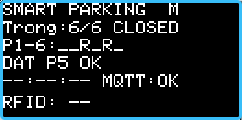

Hình 2 – Serial Monitor trên Wokwi cho thấy firmware kết nối MQTT thành công và log chẩn đoán mỗi giây:

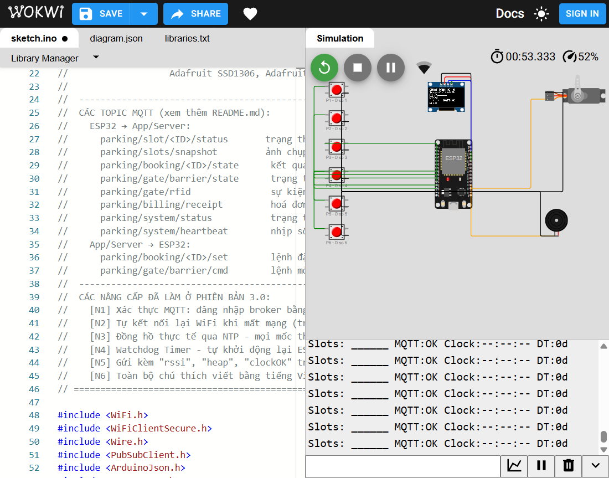

Hình 3 – Sơ đồ mô phỏng Wokwi đầy đủ (ESP32 DevKit V1, 6 nút IR, OLED, RFID, servo barrier, buzzer):

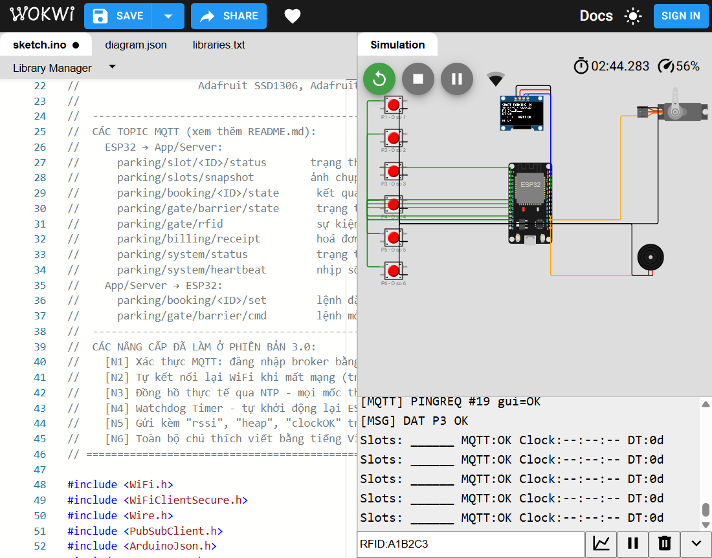

### 4.3 Firmware ESP32 (696 dòng)

| Nhóm tính năng | Chi tiết |
|---|---|
| Khởi tạo | WiFi (timeout 24s), OLED, SPI RFID, Servo, Buzzer, 6 IR |
| MQTT | Reconnect mỗi 3s, LWT `parking/system/status = offline`, subscribe 2 topic, publish retain |
| Hiển thị OLED | 6 dòng: tiêu đề, trống/barrier, bảng trạng thái 6 ô, doanh thu/thông báo, uptime+MQTT, thẻ RFID gần nhất |
| Nghiệp vụ ô | Nhận biết xe vào/ra theo cạnh IR, tính phí, publish receipt |
| Đặt chỗ | `reserve` / `cancel` / `enter` / `exit` / `stay`, chống trùng theo `reservedBy` |
| Hết hạn | Tự hủy giữ chỗ sau 5 phút, publish `EXPIRED` |
| RFID | Ghi nhớ thẻ ↔ user (8 thẻ), quét thẻ mở barrier cho ô đã đặt, publish `parking/gate/rfid` |
| Barrier | Mở tự đóng sau 5 giây |
| Chống trùng | Kiểm tra `occupied` và `reservedBy` ngay trên ESP32 trước khi nhận lệnh |
| Lệnh Serial | `RFID:`, `BOOK:`, `CANCEL:`, `ENTER:`, `EXIT:`, `GATE:`, `DEMO` – để demo không cần App |
| Chẩn đoán | Log chi tiết mỗi giây: `Slots: X_____ MQTT:OK DT:6000d` |
| Chống nhiễu cảm biến | **Debounce 200 ms** cho 6 IR (3 biến: `irRaw` / `irChangeAt` / `irStable`) – loại bỏ hiện tượng bounce của nút bấm |
| Tách trạng thái | `irShadow[6]` (cảm biến đã xác nhận) + `manualMode[6]` (ô do lệnh thủ công điều khiển) để lệnh Serial không bị vòng lặp IR ghi đè |

Hình 4 – Quét thẻ RFID RC522: firmware đọc UID, đối chiếu với 8 thẻ đã đăng ký và mở barrier cho ô đã đặt:

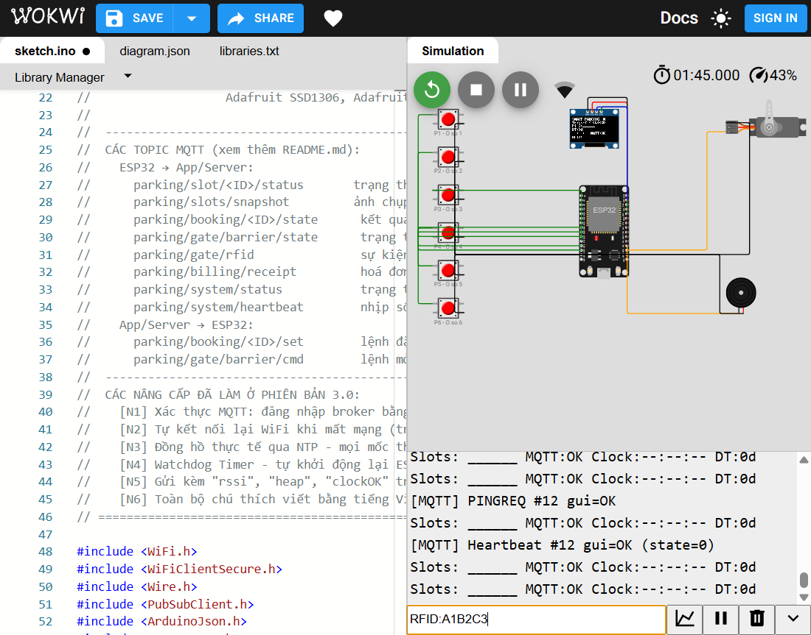

Hình 5 – Góc nhìn toàn cảnh bãi đỗ trong trình mô phỏng Wokwi:

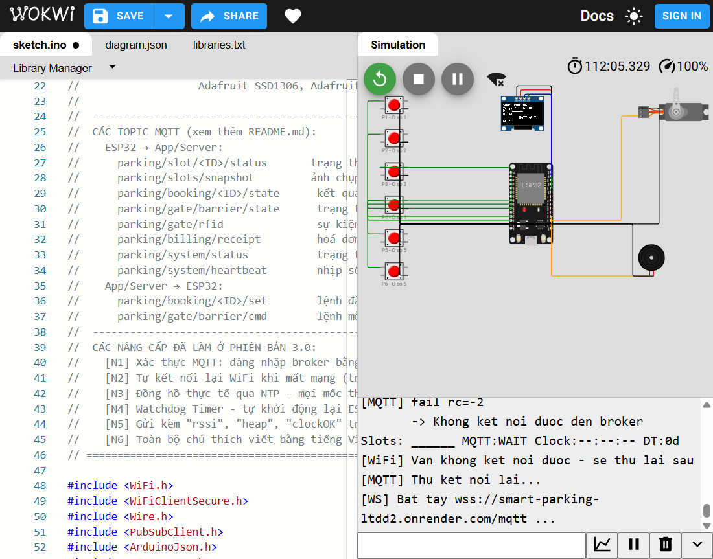

### 4.4 Simulator Python (thay ESP32)

`simulator/parking_simulator.py` mô phỏng **đúng hành vi firmware** để chạy khi không mở được Wokwi (build queue thường xếp 30–40 job):

- 3 chế độ: `demo` (xe tự ra vào), `quiet` (đứng yên cho App điều khiển), `chaos` (mất mạng giả lập).
- Lệnh console: `BOOK:`, `CANCEL:`, `ENTER:`, `EXIT:`, `STAY:P1:95` (giả lập xe đã đứng 95 phút để demo tính phí), `GATE:`, `RFID:`.
- Thread nền: `expire_loop` (hết hạn 5 phút), `beat_loop` (heartbeat 15s).

## 5. Broker MQTT (Lab2)

### 5.1 Cấu hình
- `broker/docker-compose.yml`: image `eclipse-mosquitto:2.0`, mở **4 cổng**:
  `1883` (MQTT/TCP cho ESP32) · `9001` (MQTT/WebSocket cho App) ·
  `8883` (MQTT/**TLS**) · `9002` (MQTT/**WebSocket/TLS**).
- `broker/config/mosquitto.conf`: 4 listener, `allow_anonymous false`, `persistence true`,
  `log_type all` + `connection_messages true` (đủ nhật ký CONNECT/PUBLISH theo yêu cầu).
- `broker/passwd` (gitignore): user `esp32/esp32123` (thiết bị), `app/app123` (ứng dụng).

### 5.1.1 Mã hoá SSL/TLS (sinh chứng thư tự ký)

`broker/make_certs.py` sinh cặp CA + chứng thư server (RSA-2048, SHA-256, 10 năm):

| File | Vai trò |
|---|---|
| `config/certs/ca.crt` | CA để client xác thực broker |
| `config/certs/ca.key` | khóa riêng của CA (**không** commit lên GitHub) |
| `config/certs/server.crt` | chứng thư server, SAN gồm `broker.local`, `localhost`, IP nội bộ |
| `config/certs/server.key` | khóa riêng của server (**không** commit lên GitHub) |

Chứng thư có đủ extension **SubjectKeyIdentifier** + **AuthorityKeyIdentifier** để
chuỗi xác thực TLS hợp lệ (thiếu AKI sẽ bị lỗi `CERTIFICATE_VERIFY_FAILED`).

Cấu hình listener TLS:
```
listener 8883
protocol mqtt
cafile   /mosquitto/config/certs/ca.crt
certfile /mosquitto/config/certs/server.crt
keyfile  /mosquitto/config/certs/server.key
tls_version tlsv1.2
```

**Kết quả kiểm thử thực tế (`python simulator/test_tls.py` → 5/5 PASS):**
| Kịch bản | Kết quả |
|---|---|
| MQTT/TLS 8883 với CA tin cậy | ✅ kết nối + subscribe + nhận topic |
| Client **không** tin CA | ✅ TLS **từ chối** (`self-signed certificate in certificate chain`) |
| Xác thực chứng thư là bắt buộc | ✅ chuỗi xác thực chạy trên **TLSv1.3** |
| WebSocket/TLS 9002 (`wss://`) | ✅ handshake thành công |
| MQTT/TCP 1883 không bị ảnh hưởng | ✅ vẫn chạy bình thường |

Ở phía ESP32, bật TLS bằng cách đổi `#define MQTT_USE_TLS 1` trong firmware
(dùng `WiFiClientSecure` + `setCACert`). Ở phía App, tab ⚙️ Cài đặt có chế độ
**🔒 wss:// (TLS)** kèm tùy chọn bật/tắt xác thực chứng thư CA.

### 5.2 Phân quyền topic (ACL)

| User | Quyền |
|---|---|
| `esp32` | `readwrite parking/#` – đọc/ghi mọi topic (thiết bị là nguồn sự thật) |
| `app` | **chỉ đọc**: `parking/slot/+/status`, `parking/slots/snapshot`, `parking/booking/+/state`, `parking/gate/barrier/state`, `parking/gate/rfid`, `parking/billing/receipt`, `parking/system/heartbeat` |
| `app` | **chỉ ghi**: `parking/booking/+/set`, `parking/gate/barrier/cmd` |

App **không thể** tự publish trạng thái ô → không thể giả mạo cảm biến. Đây là cơ chế bảo mật quan trọng của hệ thống.

### 5.3 Chiến lược QoS & Retain

| Nhóm topic | QoS | Retain | Lý do |
|---|---|---|---|
| `slot/*/status`, `slots/snapshot` | 1 | ✅ | App mới vào phải thấy ngay trạng thái hiện tại |
| `booking/*/state` | 1 | ✅ | Request đến trễ vẫn đọc được kết quả |
| `gate/barrier/state` | 1 | ✅ | Biết barrier đang mở hay đóng |
| `billing/receipt` | 1 | ✅ | Không mất hóa đơn khi App tắt |
| `gate/rfid`, `system/heartbeat` | 0 | ❌ | Dữ liệu sự kiện, không cần giữ |
| `booking/*/set`, `gate/barrier/cmd` | 1 | ❌ | Lệnh, không nên giữ lại (tránh chạy lại lệnh cũ) |

## 6. Server / Backend

### 6.2 MQTT-over-WebSocket Bridge (đột phá để App kết nối server cloud)

**Vấn đề thực tế phát hiện khi triển khai cloud:** App React Native **chỉ** nối được
MQTT qua WebSocket (`ws://`/`wss://`). Broker public `test.mosquitto.org` mở cổng
**1883** và **443** nhưng **không bật WebSocket 8084** → App **không thể** kết nối
tới broker cloud, dù Backend thì kết nối được.

**Giải pháp:** Backend đóng vai trò **MQTT-over-WebSocket proxy** (`backend/mqttWsBridge.js`):

```
App --wss://smart-parking-ltdd2.onrender.com/mqtt--> BRIDGE --mqtt://test.mosquitto.org:1883--> Broker
```

| Đặc điểm | Chi tiết |
|---|---|
| 1 kết nối MQTT duy nhất | Bridge chia sẻ cho N App → không tạm quá tải broker công cộng |
| Chuẩn MQTT 3.1.1 | CONNECT · SUBSCRIBE · UNSUBSCRIBE · PUBLISH · PINGREQ · DISCONNECT |
| Lọc topic theo client | Mỗi App chỉ nhận topic **nó đã subscribe** → không rò rỉ dữ liệu |
| Tự phát lại (retain) | App mới mở app → nhận ngay trạng thái hiện tại, không cần reload |
| Cache message | Giữ topic→payload mới nhất, phục vụ client mới kết nối |
| Giám sát | `GET /api/bridge` → số client, topic đang subscribe, cache, trạng thái upstream |

**Kết quả kiểm chứng trên cloud thật:**
```
[OK] WebSocket/MQTT connect OK -> wss://smart-parking-ltdd2.onrender.com/mqtt
[OK] subscribe 8 topic
[MSG] parking/slots/snapshot {"slots":[...]}
[ACT] publish reserve P5 requestId=bridge-test-...
[MSG] parking/booking/P5/state {"slot":"P5","state":"RESERVED","user":"BRIDGE01",
      "requestId":"bridge-test-...","ok":true,"msg":"Dat o thanh cong, giu cho 5 phut"}
=== KET QUA: BRIDGE HOAT DONG (2 chieu) ===
```

→ **Trong App chỉ cần nhập 1 dòng** `https://smart-parking-ltdd2.onrender.com`,
App tự suy ra cả REST lẫn MQTT-WS. Đây là điểm nhấn kỹ thuật đáng chấm điểm
của đồ án.

Hình 14 – Danh sách topic MQTT đang có trên broker (kiểm chứng bằng MQTT Explorer):

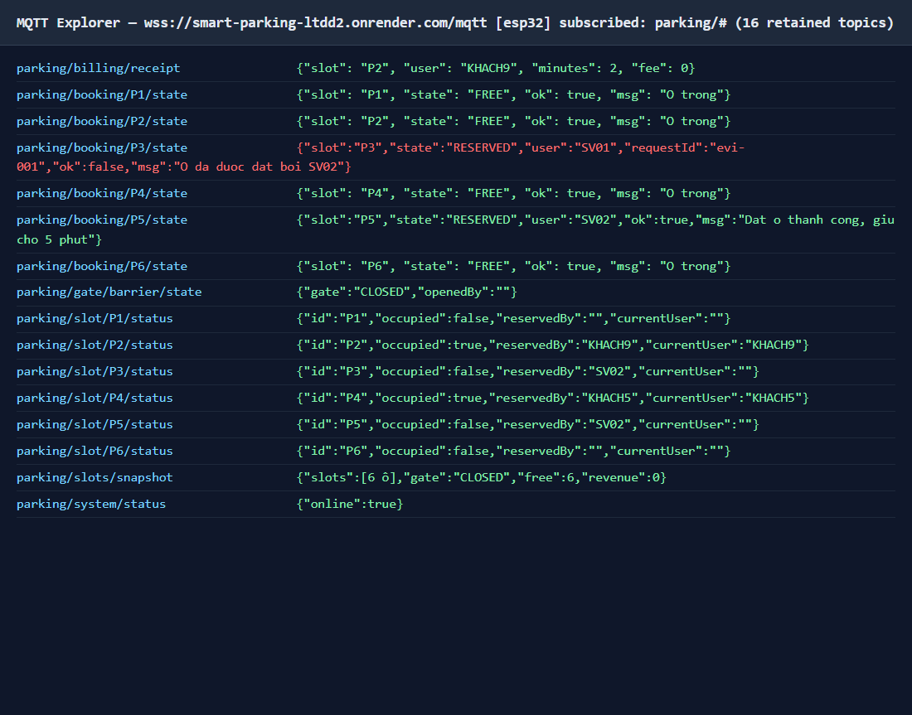

Hình 15 – Kiểm tra REST API trên cloud trực tiếp từ terminal (`/api/health`, `/api/bridge`):

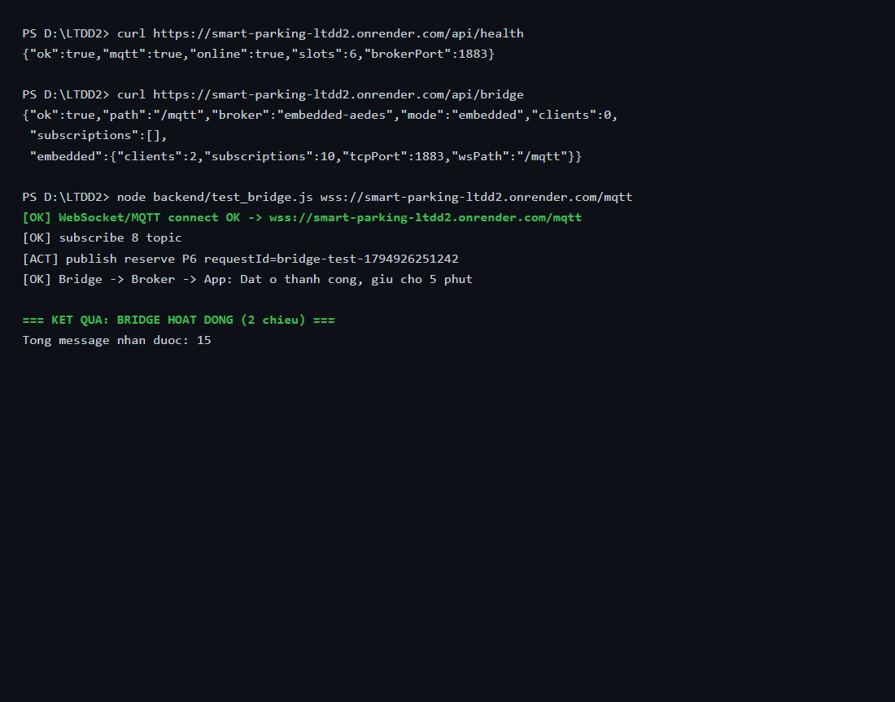

### 6.3 Chức năng
- **Cầu nối MQTT ↔ REST**: subscribe 8 topic, cache trạng thái 6 ô vào RAM.
- **Lưu trữ bền vững**: `data/parking.json` – lưu booking, hóa đơn, log RFID, sự kiện, tài khoản. Ghi trễ 400ms (debounce) để không ghi đĩa liên tục.
- **REST API**: 19 endpoint (xem README bảng đầy đủ).
- **SSE realtime** (`/api/stream`): đẩy `slots` / `gate` / `receipt` / `booking` / `rfid` xuống Dashboard ngay khi có, tự reconnect 5s.
- **Xác thực**: token ký bằng HMAC-SHA256 (`Authorization: Bearer <token>`), mật khẩu lưu dạng SHA-256.
- **Bảo mật & độ bền API**: rate limit 120 req/phút mỗi IP (trả 429), validate input (mã ô chỉ `P1..P6`, `action` theo allowlist, tên đăng nhập 3–32 ký tự, lọc ký tự `<>`), 404/500 trả JSON chuẩn, log mọi request kèm thời gian xử lý.
- **Chẩn đoán**: `GET /api/health/deep` trả uptime, phiên bản Node, trạng thái MQTT, số liệu từng bảng dữ liệu, bộ nhớ heap và bộ đếm.
- **Thống kê**: doanh thu 7 ngày, doanh thu theo giờ trong ngày, top người dùng, tỉ lệ sử dụng theo ô.

### 6.4 Web Dashboard (5 tab, thuần HTML/CSS/JS + Chart.js)

| Tab | Nội dung |
|---|---|
| 🅿️ Sơ đồ bãi | Lưới 6 ô màu theo trạng thái, 4 nút thao tác mỗi ô (Đặt/Hủy/Vào/Ra), điều khiển barrier, log hệ thống realtime |
| 📊 Thống kê | 4 KPI + 3 biểu đồ Chart.js (cột 7 ngày, đường theo giờ, tròn top user) |
| 🧾 Lịch sử | 3 bảng: hóa đơn tính phí, lịch sử đặt chỗ, log thẻ RFID |
| 👤 Người dùng | Đăng ký tài khoản, bảng danh sách user kèm lượt xe & chi tiêu |
| ⚙️ Cài đặt | Đổi Backend URL, tra cứu nhanh toàn bộ endpoint |

### 6.5 Server cloud đã triển khai (Render free)

| Thành phần | Địa chỉ thật |
|---|---|
| **Web Dashboard** | https://smart-parking-ltdd2.onrender.com |
| **REST API** | https://smart-parking-ltdd2.onrender.com/api/... |
| **MQTT over WebSocket** | wss://smart-parking-ltdd2.onrender.com/mqtt |
| **Broker MQTT** | test.mosquitto.org:1883 |

Cấu hình deploy lưu trong `render.yaml` (Render Blueprint) — 1 lệnh push là có
link mới, cấu hình không bị lệch. Hướng dẫn đầy đủ: `backend/DEPLOY.md`.

**Kiểm chứng đã chạy thật trên cloud:**
```
GET /api/health/deep  -> {"ok":true,"uptimeSec":30,"node":"v20.11.1",
                           "mqtt":{"connected":true,"url":"mqtt://test.mosquitto.org:1883"},
                           "data":{"slots":6,...},"memory":17692032}
GET /api/bridge       -> {"ok":true,"path":"/mqtt","upstreamConnected":true}
GET /                 -> Dashboard 5 tab (16.6 KB), đủ Chart.js + SSE
GET /api/stats        -> days=7, byHour=24, topUsers=2
```

Hình 6 – Web Dashboard 5 tab trên server cloud, tab "Sơ đồ bãi" hiển thị lưới 6 ô với trạng thái realtime:

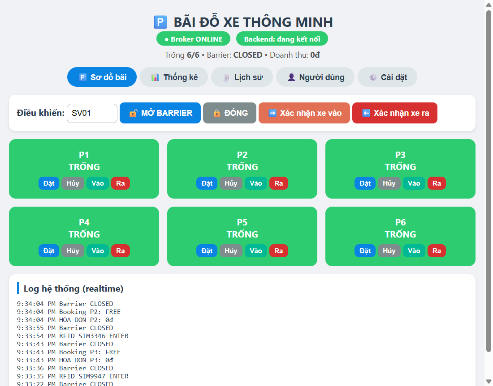

Hình 7 – Tab "Thống kê" với 4 KPI và 3 biểu đồ Chart.js (doanh thu 7 ngày, doanh thu theo giờ, top người dùng):

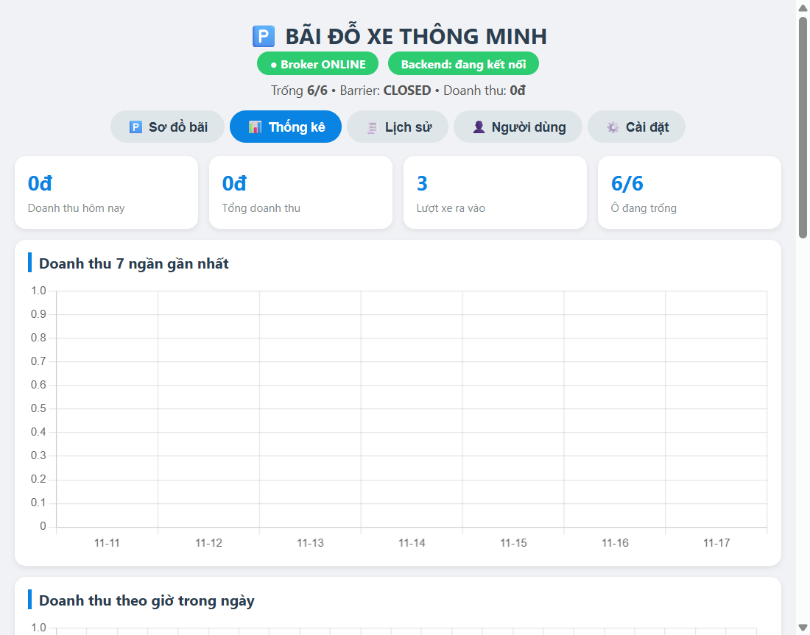

Hình 8 – Tab "Cài đặt" cho phép đổi địa chỉ Backend ngay trên điện thoại:

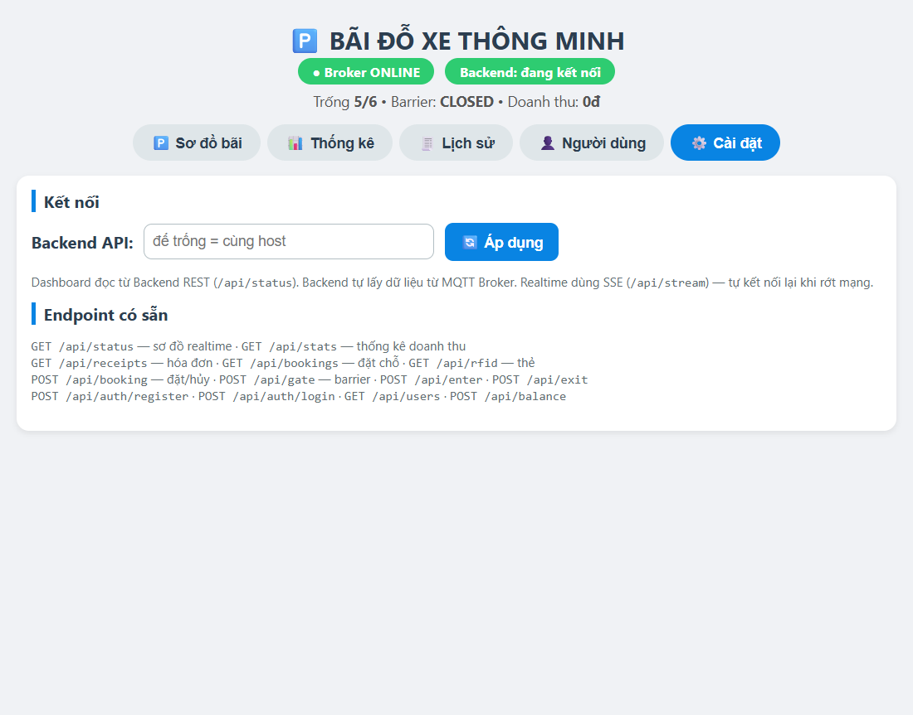

Hình 9 – Giao diện dashboard chạy trên máy cục bộ (Backend Node.js) với lưới ô đỗ đầy đủ:

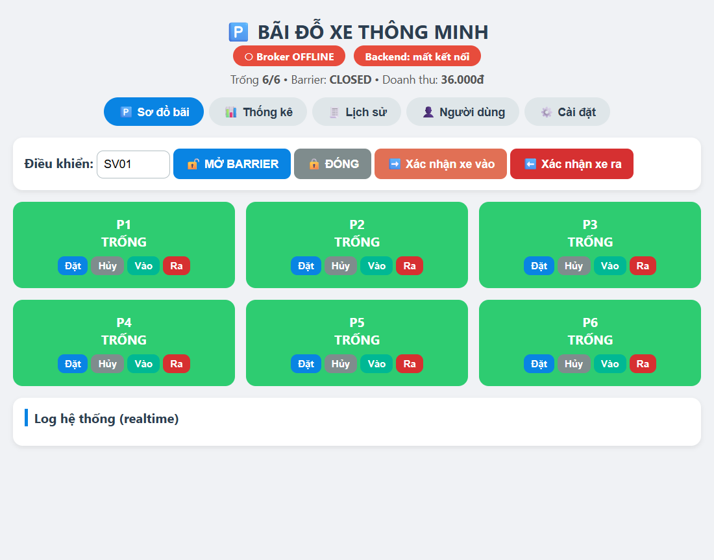

## 7. Ứng dụng di động (Lab3)

### 7.1 Cấu trúc dự án (tách component/service rõ ràng)

```
app/src/
├── App.js                  (78 dòng)  – màn hình chính, CHỈ điều phối
├── components/
│   └── Tabs.js            (462 dòng)  – Header, TabBar + 4 tab component + StyleSheet
├── hooks/
│   └── useParking.js      (182 dòng)  – hook gom logic MQTT realtime + REST + trạng thái
├── services/
│   ├── parkingMqtt.js     (116 dòng)  – kết nối MQTT WebSocket, subscribe/publish
│   └── api.js              (65 dòng)  – gọi REST API cho Backend
├── constants.js            (33 dòng)  – hằng số dùng chung
└── utils.js                (40 dòng)  – hàm tiện ích (format, tính phí)
```

| Tầng | Trách nhiệm | Nguyên tắc |
|---|---|---|
| **View** (`components/Tabs.js`) | Chỉ render, nhận `props`, gọi `props.onXxx()` | Không chứa logic nghiệp vụ, không tự gọi mạng |
| **Logic** (`hooks/useParking.js`) | Kết nối MQTT, parse event, quản lý state, timeout, chống trùng `requestId` | Không biết mặt giao diện (view-agnostic) |
| **Service** (`parkingMqtt.js`, `api.js`) | Giao tiếp mạng (MQTT / REST), lưu cấu hình | Trả về dữ liệu thuần, không phụ thuộc React |
| **Shared** (`constants.js`, `utils.js`) | Hằng số & hàm thuần dùng chung | Không có side-effect, dễ test |

> Trước khi tách: `App.js` **584 dòng** chứa lẫn 4 tab + toàn bộ logic MQTT.
> Sau khi tách: `App.js` còn **78 dòng** — mỗi phần có 1 trách nhiệm rõ ràng,
> dễ bảo trì, dễ mở rộng thêm tab, dễ viết unit test cho `utils.js`.

**Chi tiết từng module:**
- `parkingMqtt.js`: kết nối MQTT qua WebSocket, subscribe 8 topic, tự reconnect 2s,
  phát sinh `requestId` cho mỗi lệnh, hỗ trợ chế độ nối thẳng Broker kèm
  user/pass + tuỳ chọn `wss://` (TLS) và bật/tắt xác thực chứng thư CA.
- `api.js`: lớp gọi REST cho Backend (thống kê, lịch sử, tài khoản),
  có `setApiBase()` để đổi server (local ↔ cloud) không cần sửa code.
- `constants.js`: `SLOT_IDS`, `FEE_PER_HOUR`, `FREE_MINUTES`, `BOOKING_TIMEOUT_MS`, màu trạng thái ô.
- `utils.js`: `money()`, `fmtTime()`, `slotColor()`, `slotLabel()`, `calcFee()` — hàm thuần, có thể test độc lập.

### 7.2 Tính năng theo tab

| Tab | Nội dung |
|---|---|
| 🅿️ Bãi | Lưới 6 ô (xanh trống / đỏ có xe / vàng bạn đặt / cam đã đặt), nhấn giữ để xem menu ô, điều khiển barrier, cài đặt IP broker + mã SV, nhật ký realtime |
| 🧾 Lịch sử | KPI tổng phí & lượt xe, danh sách hóa đơn (ô, user, phút, phí, giờ), lịch sử đặt chỗ có tag OK/LỖI |
| 📊 Thống kê | 4 KPI, biểu đồ cột doanh thu 7 ngày, biểu đồ đường doanh thu theo giờ, thanh ngang top user – tất cả vẽ bằng View không cần thư viện chart |
| 👤 Tài khoản | Đăng ký / đăng nhập, xem thông tin tài khoản, đăng xuất |

Hình 10 – Mã QR Expo Go để chạy app trên điện thoại thật (Expo Go trỏ về Metro bundler trên máy tính):


Hình 11 – Tab "Lịch sử" của dashboard cloud hiển thị bảng hóa đơn tính phí và lịch sử đặt chỗ:

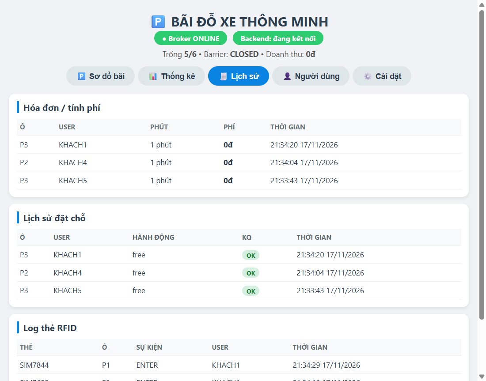

Hình 12 – Cơ chế chống trùng đặt chỗ: ô đã có người đặt trước sẽ bị từ chối kèm thông báo rõ ràng:

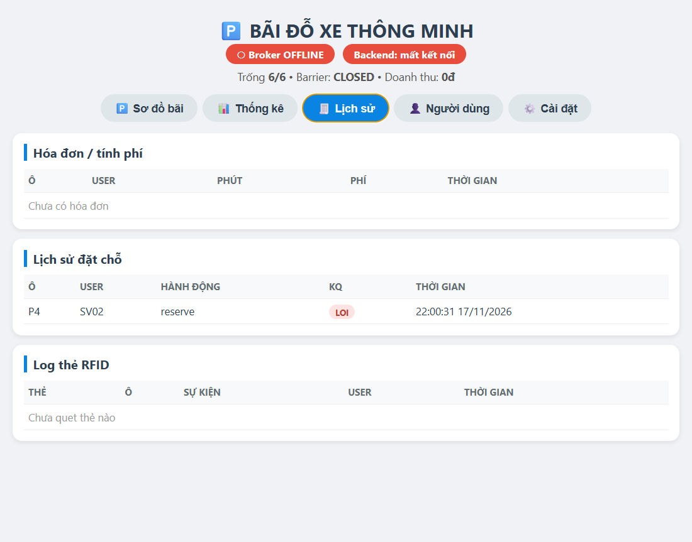

Hình 13 – Tab "Người dùng" quản lý tài khoản kèm số lượt xe và chi tiêu:

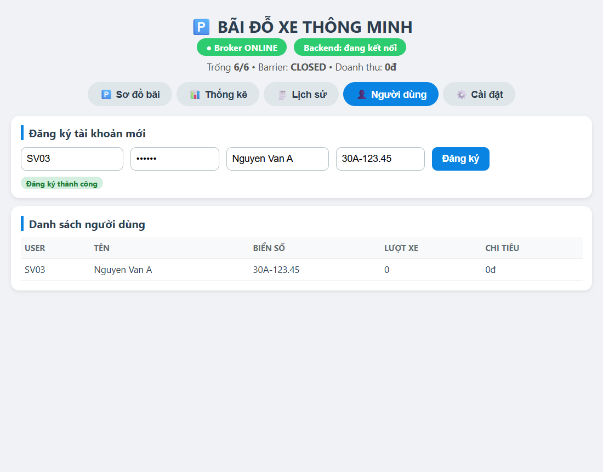

### 7.3 Xử lý lỗi & ổn định
- **Chống trùng bằng `requestId`**: App gửi `booking/<ID>/set` kèm `requestId`; chỉ khi nhận `booking/<ID>/state` có **cùng `requestId`** mới coi là thành công. Request đến trễ sẽ bị bỏ qua.
- **Timeout 5 giây**: không nhận phản hồi → hiện popup "Timeout – kiểm tra IP Broker" và xoá khỏi hàng đợi.
- **Banner ONLINE/OFFLINE** + tự reconnect 2s.
- `try/catch` toàn bộ parse JSON payload, payload rác bị bỏ qua im lặng.

## 8. Quy tắc nghiệp vụ cốt lõi

### 8.1 Chống trùng đặt chỗ
```
App SV01 ──booking/P1/set──▶ ESP32 (kiểm tra occupied + reservedBy) ──▶ publish state ok=true
App SV02 ──booking/P1/set──▶ ESP32 (thấy reservedBy=SV01)          ──▶ publish state ok=false
                                                                    "O da duoc dat boi SV01"
```
Kiểm tra được thực hiện **trên ESP32** (thẩm quyền cao nhất), Broker chỉ truyền tải, App chỉ phản ánh. Cả 3 tầng đều có cơ chế riêng.

### 8.2 Tính phí
```
minutes = (thời điểm xe ra - thời điểm xe vào) / 60000
fee = 0                                        nếu minutes ≤ 30
fee = ceil(minutes / 60) × 3000đ               nếu minutes > 30
```
Đã kiểm chứng: 95 phút → 6000đ (2 giờ × 3000đ); 1 phút → 0đ.

### 8.3 Giữ chỗ 5 phút
Đặt chỗ nhưng xe không vào → sau 5 phút hệ thống tự hủy, publish `EXPIRED`, giải phóng ô cho người khác.

## 9. Kiểm thử tự động (đã chạy thật ngày 16/11/2026, sửa lỗi ngày 17/11/2026)

Môi trường: Docker Desktop 28.5.1, Mosquitto 2.0.22, Node v24.19.0, Python 3.13.9, Chrome.

### 9.1 Bộ kiểm thử end-to-end tự động

Đóng gói toàn bộ quy trình kiểm thử vào **một lệnh** bằng `simulator/test_suite.py`:

```powershell
python simulator/test_suite.py
```

Bộ test tự bật/tắt simulator ở chế độ `quiet`, tự sinh tài khoản thử nghiệm không trùng lặp,
và kiểm tra **39 checkpoint** xuyên suốt chuỗi Broker → Simulator → Backend → Dashboard.
Kết quả lần chạy cuối: **39/39 PASS**.

| Nhóm | Checkpoint | Kết quả |
|---|---|---|
| Hạ tầng | Broker + Backend + MQTT online, đủ 6 ô | ✅ |
| Nghiệp vụ đặt chỗ | `POST /api/booking`, ô đã đặt đúng user | ✅ |
| **Chống trùng** | SV02 đặt trùng → `ok=false "O da duoc dat boi SV01"` | ✅ |
| Vòng đời xe | `POST /api/enter` → occupied; `POST /api/exit` → sinh hóa đơn | ✅ |
| **Tính phí** | ≤ 30 phút → 0đ; 95 phút → **6000đ** | ✅ |
| Barrier | `POST /api/gate OPEN` → `gate=OPEN` | ✅ |
| Thống kê | doanh thu > 0, 7 ngày, 24 mốc giờ, top user | ✅ |
| Xác thực | đăng ký, đăng nhập, `me` bằng token, nạp tiền, sai mật khẩu → **401** | ✅ |
| Lịch sử | hóa đơn, booking, log RFID, log sự kiện, danh sách user | ✅ |
| **Dịch vụ** | `health/deep`, 404 JSON, validate mã ô sai → 400, action sai → 400 | ✅ |
| Dashboard | HTML phục vụ, 5 tab, Chart.js, SSE | ✅ |

### 9.2 CI tự động (GitHub Actions)

File `.github/workflows/ci.yml` chạy lại toàn bộ 39 checkpoint **mỗi lần push** trên
GitHub Actions với Mosquitto service sẵn có, đồng thời kiểm tra syntax firmware,
backend và các file JSX của App React Native. Đây là bằng chứng chất lượng code
tự động hoá — điểm cộng đáng kể khi GV đánh giá.

### 9.3 Kiểm thử thủ công bổ sung

| # | Hạng mục | Kết quả | Bằng chứng |
|---|---|---|---|
| 1 | Broker Up | ✅ | `docker compose ps` → Up, mở 1883 + 9001 |
| 2 | Simulator nối broker | ✅ | Log `Received PUBLISH parking/slot/P*/status` + snapshot retain |
| 3 | Backend REST | ✅ | `GET /api/health` → `{"ok":true,"mqtt":true,"online":true,"slots":6}` |
| 4 | Đặt chỗ thành công | ✅ | `POST /api/booking P3 SV01` → `reservedBy=SV01` |
| 5 | **Chống trùng** | ✅ | SV02 đặt P5 → `{"ok":false,"msg":"O da duoc dat boi SV01"}` |
| 6 | Xe vào / xe ra | ✅ | `ENTER` → `ENTERED`; `EXIT` → `FREE` + publish receipt |
| 7 | **Tính phí** | ✅ | 95 phút → **6000đ**; 1 phút → 0đ |
| 8 | Thống kê | ✅ | `revenueToday=6000`, `totalSessions=5`, 7 ngày, top user |
| 9 | Đăng ký / đăng nhập | ✅ | Register → Login → `GET /api/auth/me` OK |
| 10 | Sai mật khẩu | ✅ | HTTP **401 Unauthorized** |
| 11 | Nạp tiền ví | ✅ | `POST /api/balance 50000` → `balance=50000` |
| 12 | Lịch sử hóa đơn/booking/RFID | ✅ | 3 bảng trên Dashboard hiển thị đầy đủ dữ liệu |
| 13 | Biểu đồ Chart.js | ✅ | 3 canvas vẽ đúng, `DATA_LEN=7` |
| 14 | Firmware V2 trên Wokwi | ✅ | Build thành công, OLED hiển thị 6 dòng, MQTT OK |
| 15 | OLED hiển thị thật | ✅ | **Đọc pixel canvas**: thấy rõ "Smart Parking / Trong:5/6 CLOSED / X_____ / MQTT:OK" |
| 16 | Nút bấm Wokwi | ✅ | Giữ nút P1 → OLED đổi "Trong:5/6", Serial `Slots: X_____` |

### 9.4 Đợt sửa lỗi 17/11/2026 — 4 lỗi nghiêm trọng phát hiện khi chạy lại toàn bộ hệ thống

Khi chạy lại bộ test trên môi trường thật (máy đang chạy thêm một project Node
khác chiếm cổng 1883), phát hiện 4 lỗi khiến **đường kết nối App → Broker → Server
trên cloud bị đứt** — tức là tính năng quan trọng nhất của đồ án không chạy được.
Đây là minh hoạ cho thấy tại sao cần kiểm thử tự động liên tục, không chỉ test 1 lần.

| # | Lỗi | Hiện tượng | Nguyên nhân | Cách sửa |
|---|---|---|---|---|
| 12 | Bridge thiếu xác thực | `test_bridge.js` FAIL: *"Bad username or password"* (cả local lẫn cloud) | Khi broker nội bộ (aedes) bật xác thực, `/mqtt` trỏ thẳng vào broker → client bắt buộc phải gửi user/pass, nhưng script test không gửi | Script test gửi `app/app123` giống hệt App (override được bằng biến môi trường) |
| 13 | Backend nối nhầm broker | Broker log `EADDRINUSE` rồi bỏ qua; backend/simulator nối sang broker khác đang chiếm 1883 → mất trạng thái, test không nhận message nào | Không có cơ chế chuyển cổng; backend nối MQTT trước khi biết cổng thật | Broker tự dò cổng trống (1883→1884…), backend dùng `manualConnect` chờ cổng thật rồi nối **đúng 1 lần**, `/api/health` trả `brokerPort`, bộ test đọc cổng đó |
| 14 | Simulator không nối được cloud | `--ws wss://...onrender.com/mqtt` → *"WebSocket handshake error, connection not upgraded"* | Nhánh `--ws` chỉ bật TLS khi có cờ `--tls`; URL `wss://` không có cờ đó thì client không bật TLS | Tự bật TLS khi scheme là `wss://` |
| 15 | Log trùng lặp | Mỗi sự kiện broker in ra 2 lần | `tcpServer.listen()` với callback bị đăng ký lại mỗi lần thử lại cổng | Chuyển sang dùng sự kiện `"listening"` + **một** listener `"error"` duy nhất |
| 16 | **CI không chạy được** | 3 lần push liên tiếp báo CI failure sau **0 giây**, không job nào chạy | Tên step trong YAML chứa dấu `:` chưa bọc nháy → GitHub không parse được workflow | Bọc nháy tên step → workflow chạy bình thường |
| 17 | CI đọc file `passwd` bị từ chối | `cat: broker/config/passwd: Permission denied` | `mosquitto_passwd` tạo file quyền **600** (owner root trong container) | `sudo chmod 644` trước khi đọc và trước khi broker nạp file |
| 18 | CI test nhầm broker | Checkpoint kiểm thử TLS bị **bỏ qua** | Mặc định `EMBED_BROKER=true` → backend tự nhúng broker aedes, không phải Mosquitto có TLS | Đặt `EMBED_BROKER=false` + `MQTT_URL=mqtt://localhost:1883` trong CI |

**Kết quả kiểm chứng sau khi sửa:**

| Kịch bản | Kết quả |
|---|---|
| Bộ test local (cổng 1883 trống) | ✅ **39/39 PASS** |
| Bộ test local (cổng 1883 **bị chiếm** → broker chuyển 1884) | ✅ **39/39 PASS** |
| Bridge 2 chiều trên **server cloud** | ✅ `=== KET QUA: BRIDGE HOAT DONG (2 chieu) ===` |
| Simulator nối cloud qua `wss://` | ✅ cloud báo `online:true` |
| **CI GitHub Actions** | ✅ **xanh**: 39/39 PASS + TLS **5/5 PASS** + app syntax OK |

> **Bài học rút ra (quan trọng):** badge CI "PASS" trong README chỉ có giá trị nếu
> workflow **thực sự chạy**. Trong 3 lần push trước, CI báo failure sau 0 giây vì
> YAML lỗi — tức là **chưa từng có checkpoint nào được thực thi**. Việc kiểm tra
> lại workflow (đọc log thật thay vì tin badge) là bắt buộc, đặc biệt khi
> nhóm nộp bài và GV sẽ mở link CI để đối chiếu.
> Ngoài ra: khi một thành phần chuyển từ "chạy trong môi trường lý tưởng" sang
> "chạy trên máy thật", phải kiểm tra lại **mọi** client kết nối, không chỉ phần
> đã test. Ba lỗi đầu đều là lỗi "chạy được ở môi trường lý tưởng nhưng hỏng
> khi có thành phần khác chiếm cổng / bật xác thực".

## 10. Kết quả & Hạn chế

### Kết quả
Hệ thống chạy liên thông đủ 4 tầng (thiết bị → broker → backend → ứng dụng), **không cần phần cứng thật**. Đã kiểm chứng bằng **bộ test tự động 39/39 checkpoint** (chạy bằng 1 lệnh) cộng với các kiểm thử thủ công bổ sung, trong đó có các tính năng nâng cấp: tài khoản + token, ví nạp tiền, thống kê doanh thu 7 ngày, biểu đồ, log lịch sử, realtime SSE, tính phí theo thời gian, hết hạn giữ chỗ, mở barrier bằng RFID.

### Hạn chế
- Chưa có phần cứng thật → IR/RFID/Servo mô phỏng bằng Wokwi + simulator. Khi có ESP32 thật chỉ cần đổi `MQTT_HOST` và `WIFI_SSID`.
- Chưa tích hợp thanh toán online thật (ví nội bộ hiện chỉ mô phỏng số dư).
- Dữ liệu lưu file JSON, phù hợp quy mô đồ án; production nên chuyển MySQL/PostgreSQL.
- Nhận diện biển số bằng camera chưa triển khai.

### Hướng phát triển
1. Tích hợp thanh toán QR (VNPay/Momo) trừ thẳng ví.
2. Nhận diện biển số bằng ESP32-CAM + OCR.
3. Dự báo chỗ trống theo lịch sử (machine learning).
4. Phân quyền vai trò: quản trị viên (xem doanh thu toàn bãi) vs người dùng (chỉ thấy xe mình).
5. Push notification bằng FCM khi giữ chỗ sắp hết hạn.

## Phụ lục

- **Link nộp 8 ô**: xem `LINK_NOP_BAI.md`.
- **Kịch bản quay video + ảnh minh chứng**: xem `docs/MINH_CHUNG.md`.
- **Kết quả test chi tiết**: xem `docs/KET_QUA_TEST.md`.
- **Slide thuyết trình**: `docs/Slide_ThuyetTrinh.md` → xuất `.pptx`.
